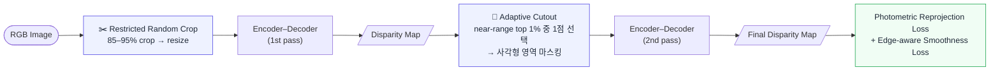

<div align="center">

# ⚡ 경량 모듈과 국소 특징 표현 강화를 통한<br/>실시간 자가 지도 단안 깊이 추정

<sub><i>Real-Time Self-Supervised Monocular Depth Estimation<br/>via Lightweight Modules and Enhanced Local Feature Representation</i></sub>

<br/>
  


<br/><br/>

[**개요**](#overview) ·
[**핵심 결과**](#highlights) ·
[**방법**](#method) ·
[**실험 결과**](#results) ·
[**시작하기**](#getting-started)

</div>

<br/>

<p align="center">
  
</p>

<p align="center"><sub><b>Figure 1.</b> 제안하는 단안 깊이 추정 네트워크 아키텍처 (StarNext + ADC + LGFI)</sub></p>

<br/>

---

<a id="overview"></a>

## 📌 개요

이 저장소는 **동의대학교 대학원 이재영 공학석사학위논문**(2026.02)의 구현 코드입니다.
경량 자가 지도 단안 깊이 추정 모델인 [Lite-Mono](https://github.com/noahzn/Lite-Mono)를 기반으로, **저전력 임베디드 환경에서의 실시간 추론**을 목표로 네트워크를 재설계했습니다.

### 왜 만들었나요?

Lite-Mono는 대표적인 경량 모델이지만, **Jetson Orin Nano** 의 저전력 모드에서는 여전히 부담이 큽니다.

> Lite-Mono는 **7W 모드에서 36.613 ms** 로, 실시간 기준인 30 FPS(33.3 ms)를 넘어섭니다.
> 15W 모드에서도 단일 모델이 연산 자원의 약 50% 이상을 사용하기 때문에, 보조 AI 모델이나 부가 알고리즘과 함께 운용하기 어렵습니다.

더불어 모델을 경량화하면 표현력(capacity)이 줄어 **세밀한 국소 구조**(표지판 지지대, 가로등, 근거리 물체 경계 등)를 놓치기 쉽습니다.
이 프로젝트는 **"더 가볍게, 그러나 국소 특징은 더 잘 보게"** 를 목표로 합니다.

### 무엇을 제안했나요?

| 구성 요소 | 한 줄 요약 | 적용 위치 |
|:--|:--|:--|
| 🌟 **StarNext** | star operation(원소별 곱)으로 채널 수 증가 없이 암묵적 고차원 표현력 확보 | Encoder · Stage 2 (1개) |
| 🧭 **ADC** *(Asymmetric Dilated Convolution)* | 비대칭 커널 + 팽창 depthwise 합성곱으로 방향성 구조 특징 추출 | Encoder · Stage 2–4 |
| ✂️ **Restricted Random Crop** | 원본의 85–95%만 무작위로 잘라 확대 → 근거리 물체·세밀한 구조 학습 빈도 증가 | 학습 (데이터 증강) |
| 🎯 **Adaptive Cutout** | 1차 disparity map에서 **근거리 상위 1% 픽셀** 주변을 마스킹 → 근거리 구조를 주변 문맥으로 학습 | 학습 (데이터 증강) |

---

<a id="highlights"></a>

## 🚀 핵심 결과

<div align="center">

<table>
  <tr>
    <td align="center" width="25%"><h3>−50%</h3><b>Parameters</b><br/><sub>3.069M → 1.520M</sub></td>
    <td align="center" width="25%"><h3>−58%</h3><b>GFLOPs</b><br/><sub>5.032 → 2.079</sub></td>
    <td align="center" width="25%"><h3>−52%</h3><b>Latency @ 7W</b><br/><sub>36.613 ms → 17.583 ms</sub></td>
    <td align="center" width="25%"><h3>0.115</h3><b>AbsRel</b><br/><sub>Lite-Mono 0.116</sub></td>
  </tr>
</table>

</div>

<p align="center">
  
</p>

- ✅ **모든 전력 모드**(MaxN Super · 25W · 15W · 7W)에서 추론 시간 약 **46–52 %** 단축
- ✅ **7W 저전력 모드에서도 17.583 ms** → 실시간 기준(33.3 ms)을 여유 있게 만족
- ✅ KITTI Eigen split에서 **AbsRel 0.116 → 0.115**, δ<1.25 정확도 **0.871** 유지

> [!NOTE]
> **Trade-off.** SqRel(0.837 → 0.852)과 RMSE(4.740 → 4.752)는 Lite-Mono가 근소하게 우세합니다. 파라미터와 연산량을 절반 가까이 줄인 대가로 생기는 작은 차이이며, 전력 제약이 클수록 속도 이득이 커집니다.

---

<a id="method"></a>

## 🧠 방법

### 1. 전체 학습 흐름

학습은 **두 번의 forward**로 진행됩니다. 먼저 증강된 입력으로 1차 disparity map을 얻고, 이를 이용해 Adaptive Cutout을 적용한 영상으로 최종 disparity map을 학습합니다.
(Adaptive Cutout은 학습에서만 사용되므로 **추론 구조에는 영향이 없습니다.**)



### 2. 인코더 재설계

Lite-Mono의 CDC 블록 중심 구성을 **StarNext + ADC** 중심으로 바꾸고, Stage 1의 고해상도 연산을 줄였습니다.

| | Lite-Mono | **Ours** |
|:--|:--:|:--:|
| Stage 1 | 3×3 Conv × 3 | 3×3 Conv × **1** |
| Stage 2 | CDC × 3 | **StarNext × 1** + **ADC × 2** |
| Stage 3 | CDC × 3 | **ADC × 2** |
| Stage 4 | CDC × 9 | **ADC × 3** |
| Stage 2–4 공통 | LGFI | LGFI |
| PoseNet | ResNet-18 | ResNet-18 |

<details>
<summary><b>🔧 경량화를 위한 세부 설계 선택</b></summary>

<br/>

- **Strided Conv 다운샘플링** — average pooling 대신 3×3 strided convolution을 사용해 edge·corner·texture 같은 깊이 단서를 보존합니다.
- **Addition 기반 skip 결합** — concatenation 대신 addition으로 멀티스케일(1/2, 1/4, 1/8) 특징을 합쳐 채널 수·메모리 사용량 증가를 막습니다.
- **StarNext는 Stage 2에만 적용** — Stage 1은 해상도가 커서 연산 비용이 높고, Stage 3–4는 해상도가 낮아 국소 특징 추출 효과가 제한적이므로, 비용과 효율의 균형점인 Stage 2를 선택했습니다.
- **GPU 친화적 채널 구성** — GPU의 SIMT 구조에 맞춰 채널 수를 설계해 병렬 처리 효율을 높였습니다.
- **LGFI 유지** — Lite-Mono의 Local–Global Feature Interaction 블록으로 강화된 국소·방향성 특징을 전역 문맥과 통합합니다.

</details>

### 3. 제안 모듈

<table>
  <tr>
    <td align="center" width="50%"></td>
    <td align="center" width="50%"></td>
    <!-- <td align="center" width="50%"></td> -->
    <!-- <td align="center" width="50%"></td> -->

  </tr>
  <tr>
    <td valign="top">

**🌟 StarNext**

1. `Expansion-Conv`로 채널 확장 (비선형 변환으로 표현력 증가)
2. 두 갈래로 분기 — **3×3 Standard Conv**(edge·texture 등 국소 특징) / **3×3 Dilated Conv**(더 넓은 수용 영역, 물체 윤곽)
3. 두 특징을 concat/add가 아닌 **star operation(원소별 곱)** 으로 결합 → 채널 수 증가 없이 *암묵적(implicit) 고차원 특징 공간* 확보
4. `Reduction-Conv`(linear bottleneck)로 원래 채널 수로 복원
5. Inverted residual 형태의 shortcut으로 정보 손실 방지

</td>
    <td valign="top">

**🧭 ADC**

1. `Expansion-Conv`(1×1)로 채널 확장
2. **1×5 / 5×1 비대칭 합성곱**으로 수평·수직 방향 특징을 각각 추출
3. 두 방향 특징을 **Concat**
4. **Dilated Depthwise Conv**로 채널별 넓은 공간 문맥 결합
5. `PW-Conv` → `Reduction-Conv`(linear bottleneck)
6. **Drop Path** + shortcut으로 일반화 성능 향상

</td>
  </tr>
</table>

### 4. 데이터 증강

<table>
  <tr>
    <td align="center" width="50%"><br/><sub><b>Restricted Random Crop</b></sub></td>
    <td align="center" width="50%"><br/><sub><b>Adaptive Cutout</b></sub></td>
    <!-- <td align="center" width="50%"><br/><sub><b>Restricted Random Crop</b></sub></td> -->
    <!-- <td align="center" width="50%"><br/><sub><b>Adaptive Cutout</b></sub></td> -->
  </tr>
</table>

**✂️ Restricted Random Crop** — 원본 이미지의 **85–95 %** 영역을 무작위로 잘라 원래 크기로 resize합니다. zoom-in 효과로 근거리 물체의 학습 빈도가 늘고, 가로등 같은 가는 구조물이 더 넓은 픽셀 영역을 차지합니다. 증강 강도를 제한(Restricted)해 장면 전체 view를 유지하므로, 경량 모델의 학습 안정성을 해치지 않습니다.

**🎯 Adaptive Cutout** — 일반 Cutout은 마스킹 위치가 무작위라 근거리 물체가 가려지지 않을 수 있습니다. 이를 보완해 **disparity map 기반으로 근거리를 집중 마스킹**합니다.

1. 입력 영상에서 1차 disparity map 예측
2. 근거리 객체는 대부분 하단에 위치하므로 **상단 30 %를 제외**
3. 나머지 영역에서 disparity 값이 큰(= 가까운) **상위 1 % 픽셀** 추출
4. 그중 **무작위 한 점**을 중심으로 사각형 영역을 제거
5. 마스킹된 영상으로 최종 disparity 학습 → 주변 문맥으로 근거리 구조를 복원하도록 유도

### 5. 손실 함수

자가 지도 학습(monocular video) 방식으로, 깊이 Ground Truth 없이 두 가지 손실을 사용합니다.

| 손실 | 설명 |
|:--|:--|
| **Photometric reprojection loss** | 예측 깊이 + 카메라 포즈로 인접 프레임을 재투영한 뒤, 원본과의 차이를 **SSIM + L1** 가중합으로 계산. scale 0·1·2에서 계산하며 정적 픽셀 오류를 줄이기 위해 **auto-masking** 적용 |
| **Edge-aware smoothness loss** | 이미지 gradient가 큰 경계에서는 깊이 변화를 허용하고, 균일한 영역에서는 깊이가 매끄럽도록 유도 (Monodepth 계열) |

---

<a id="results"></a>

## 📊 실험 결과

### 실험 환경

| 항목 | 내용 |
|:--|:--|
| 데이터셋 | KITTI · **Eigen split** (train 38,383 / val 4,267 / test 697) |
| 학습 환경 | Ubuntu 20.04 · NVIDIA GeForce RTX 4090 · RAM 32GB |
| 임베디드 평가 | **Jetson Orin Nano 8GB** · `jetson_clocks`로 CPU/GPU/메모리/EMC 클럭 고정 · **TensorRT** 최적화 |
| 전력 모드 | MaxN Super · 25W · 15W · 7W |
| 지표 | AbsRel↓ · SqRel↓ · RMSE↓ · RMSE(log)↓ · δ<1.25, δ<1.25², δ<1.25³ ↑ |

### 모델 크기 & 추론 속도

| Model | Params | GFLOPs |
|:--|--:|--:|
| Lite-Mono | 3.069M | 5.032 |
| **Ours** | **1.520M** *(−50%)* | **2.079** *(−58%)* |

| 전력 모드 | Lite-Mono | **Ours** | 단축률 | 속도 향상 |
|:--|--:|--:|--:|--:|
| MaxN Super | 9.624 ms | **5.196 ms** | −46.03 % | ×1.85 |
| 25W | 10.476 ms | **5.652 ms** | −46.1 % | ×1.85 |
| 15W | 16.934 ms | **9.098 ms** | −46.3 % | ×1.86 |
| **7W** | 36.613 ms ❌ *(> 33.3 ms)* | **17.583 ms** ✅ | **−52 %** | **×2.08** |

<sub>추론 시간은 KITTI Eigen test 697장 평균입니다. "속도 향상"은 두 추론 시간의 비(Lite-Mono ÷ Ours)로 계산한 값입니다.</sub>

> [!TIP]
> 전력 제약이 클수록 이득이 큽니다. 7W에서 Lite-Mono는 실시간 기준(33.3 ms)을 넘지만, 제안 모델은 **17.583 ms** 로 여유를 확보해 다른 모델·알고리즘과 함께 운용할 수 있는 연산 여유가 생깁니다.

### 정량 평가 (KITTI Eigen test, 697 images)

| Model | AbsRel ↓ | SqRel ↓ | RMSE ↓ | RMSE(log) ↓ | δ₁ ↑ | δ₂ ↑ | δ₃ ↑ |
|:--|:--:|:--:|:--:|:--:|:--:|:--:|:--:|
| Lite-Mono | 0.116 | **0.837** | **4.740** | 0.194 | 0.871 | 0.958 | **0.981** |
| **Ours (Proposed)** | **0.115** | 0.852 | 4.752 | 0.194 | 0.871 | 0.958 | 0.980 |

<sub>모든 모델은 동일한 학습 설정으로 비교했으며, 논문 Table 4-1 기준 Pretrained 항목은 모든 행에서 ✗ 입니다.</sub>

### Ablation Study

제안 요소를 하나씩 **제거(Without)** 하거나 **단독 사용(Only)** 하며 기여도를 검증했습니다.
(ADC를 제거한 모델은 해당 위치에 Lite-Mono의 CDC 모듈을 사용했습니다.)

**With Restricted Random Crop**

| Model | AbsRel ↓ | SqRel ↓ | RMSE ↓ | RMSE(log) ↓ | δ₁ ↑ | δ₂ ↑ | δ₃ ↑ |
|:--|:--:|:--:|:--:|:--:|:--:|:--:|:--:|
| Without ADC | 0.127 | 0.928 | 5.031 | 0.204 | 0.845 | 0.950 | 0.979 |
| Without StarNext | 0.120 | 0.923 | 4.914 | 0.198 | 0.863 | 0.954 | 0.979 |
| Without Adaptive Cutout | 0.122 | 0.909 | 4.964 | 0.202 | 0.857 | 0.952 | 0.979 |
| Only ADC | 0.120 | 0.894 | 4.852 | 0.199 | 0.861 | 0.954 | 0.979 |
| Only StarNext | 0.123 | 0.889 | 4.878 | 0.201 | 0.851 | 0.953 | 0.980 |
| Only Adaptive Cutout | 0.124 | 0.906 | 4.917 | 0.203 | 0.850 | 0.953 | 0.980 |
| **Proposed (All)** | **0.115** | **0.852** | **4.752** | **0.194** | **0.871** | **0.958** | **0.980** |

<details>
<summary><b>Without Restricted Random Crop</b> (펼쳐서 보기)</summary>

<br/>

| Model | AbsRel ↓ | SqRel ↓ | RMSE ↓ | RMSE(log) ↓ | δ₁ ↑ | δ₂ ↑ | δ₃ ↑ |
|:--|:--:|:--:|:--:|:--:|:--:|:--:|:--:|
| Without ADC | 0.124 | 0.927 | 4.937 | 0.202 | 0.856 | 0.952 | 0.979 |
| Without StarNext | 0.127 | 0.948 | 5.002 | 0.204 | 0.852 | 0.951 | 0.978 |
| Without Adaptive Cutout | 0.122 | 0.959 | 5.018 | 0.200 | 0.861 | 0.953 | 0.979 |
| Only ADC | 0.125 | 0.944 | 4.880 | 0.200 | 0.856 | 0.953 | 0.980 |
| Only StarNext | 0.124 | 0.927 | 4.930 | 0.202 | 0.854 | 0.952 | 0.979 |
| Only Adaptive Cutout | 0.124 | 0.905 | 4.917 | 0.200 | 0.856 | 0.953 | 0.981 |
| Proposed (All) | 0.121 | 0.905 | 4.904 | 0.199 | 0.860 | 0.954 | 0.980 |

</details>

**Takeaways**

- 🔹 **Restricted Random Crop을 적용한 경우**, 모든 요소를 함께 쓴 Proposed가 Without/Only 변형보다 모든 지표에서 같거나 우수합니다.
- 🔹 **Restricted Random Crop** 적용 시 근거리 오차에 민감한 **SqRel이 크게 개선**되어, 근거리 물체 깊이 추정에 기여함을 확인했습니다. (Without ADC, Only Adaptive Cutout 두 구성은 예외적으로 미세하게 좋아졌습니다.)
- 🔹 **ADC를 제거**했을 때(Random Crop 적용 기준) 모든 지표에서 가장 큰 성능 저하가 나타났습니다 — 방향성 특징 추출이 핵심 역할을 합니다.

### 정성 평가

각 그림의 위에서 아래 순서는 **Lite-Mono → Without StarNext → Without ADC → Without Adaptive Cutout → Proposed** 입니다. (클릭하면 원본 크기로 볼 수 있습니다.)

<table>
  <tr>
    <td align="center" width="33%"></a></td>
    <td align="center" width="33%"></a></td>
    <td align="center" width="33%"></a></td>

    <!-- <td align="center" width="33%"><a href="assets/fig4-1_directional.jpg"></a></td>
    <td align="center" width="33%"><a href="assets/fig4-2_near_object.jpg"></a></td>
    <td align="center" width="33%"><a href="assets/fig4-3_overall_shape.jpg"></a></td> -->
  </tr>
  <tr>
    <td align="center"><b>방향성 물체</b><br/><sub>세로로 긴 표지판 · 삼각형 형태 · 표지판–나무 사이 공간 분리</sub></td>
    <td align="center"><b>근거리 객체</b><br/><sub>표지판과 지지대 형태 · 경계 구분</sub></td>
    <td align="center"><b>전반적 형태</b><br/><sub>자동차 경계부 선명도 · 내부 깊이 균일성</sub></td>
  </tr>
</table>

- **방향성 물체** — ADC 제거 시 세로로 긴 표지판이 흐려지고 경계 분리가 무너졌습니다. 제안 모델은 삼각형 형태를 유지하고, Lite-Mono와 달리 **표지판과 나무 사이의 빈 공간**을 정확히 분리했습니다.
- **근거리 객체** — 제안 모델은 근거리 표지판 형태를 유지하며 Lite-Mono보다 **지지대 형태가 더 명확**합니다.
- **전반적 형태** — 제안 모델은 비교 모델 중 **자동차 경계부를 가장 선명하게** 표현했습니다. 다만 유리창처럼 세밀한 부분의 경계 분리는 Lite-Mono보다 다소 약했습니다.

### 한계와 향후 연구

- Lite-Mono 대비 일부 정량 지표(SqRel, RMSE)에서 개선 여지가 있습니다.
- 향후 **Stage 확장**, **Batch Augmentation**, **Consistency Regularization** 도입으로 제한된 파라미터에서도 더 다양한 변형 데이터를 일관되게 학습하도록 개선할 계획입니다.

---

<a id="getting-started"></a>

## 🛠️ 시작하기

### 설치

```bash
git clone https://github.com/MKHan91/Lite-mono_custom.git
cd Lite-mono_custom

# (권장) 가상환경
conda create -n lite-mono-custom python -y
conda activate lite-mono-custom

# PyTorch는 환경(CUDA 버전)에 맞게 https://pytorch.org 에서 설치하세요
pip install numpy opencv-python pillow matplotlib timm tensorboardX
```

> [!NOTE]
> 논문의 학습 환경은 Ubuntu 20.04 · RTX 4090 · RAM 32GB 이며, 임베디드 평가는 Jetson Orin Nano 8GB에서 수행했습니다.

### 데이터 준비

[KITTI Raw Data](https://www.cvlibs.net/datasets/kitti/raw_data.php)를 내려받아 아래와 같이 배치합니다. 기본 경로는 `./kitti_data` 이며, `--data_path`로 바꿀 수 있습니다.
학습/검증/테스트 분할 파일은 `splits/` 에 있습니다.

```text
kitti_data/
└── 2011_09_26/
    ├── 2011_09_26_drive_0001_sync/
    │   ├── image_02/data/0000000000.png
    │   └── image_03/data/0000000000.png
    └── ...
```

### 학습

```bash
python train.py \
  --data_path ./kitti_data \
  --model_name my_experiment \
  --model lite-mono \
  --split eigen_zhou \
  --weights_init scratch \
  --height 192 --width 640 \
  --batch_size 12 \
  --num_epochs 100
```

<details>
<summary><b>주요 옵션 (기본값은 <code>options.py</code> 기준)</b></summary>

<br/>

| 옵션 | 기본값 | 설명 |
|:--|:--|:--|
| `--data_path` | `./kitti_data` | KITTI 데이터 경로 |
| `--log_dir` | `./experiments/logs` | 로그 / 체크포인트 저장 위치 |
| `--model_name` | `remove_cghost_v2` | 결과를 저장할 폴더 이름 |
| `--model` | `lite-mono` | `lite-mono` · `lite-mono-small` · `lite-mono-tiny` · `lite-mono-8m` |
| `--split` | `eigen_zhou` | 학습 분할 (`eigen_zhou` · `eigen_full` · `odom` · `benchmark`) |
| `--height` / `--width` | `192` / `640` | 입력 해상도 |
| `--batch_size` | `12` | 배치 크기 |
| `--num_epochs` | `100` | 학습 epoch 수 |
| `--lr` | `0.0005 5e-6 35 0.0001 1e-5 35` | DepthNet / PoseNet 학습률 스케줄 (초기값, 최소값, 첫 주기 step) |
| `--weight_decay` | `1e-2` | AdamW weight decay |
| `--drop_path` | `0.2` | Drop path 비율 |
| `--weights_init` | `pretrained` | `pretrained` 또는 `scratch` (논문 실험은 사전학습 없이 학습) |
| `--disparity_smoothness` | `1e-3` | smoothness loss 가중치 |
| `--scales` | `0 1 2` | 손실을 계산할 스케일 |
| `--frame_ids` | `0 -1 1` | 입력 프레임 인덱스 |
| `--load_weights_folder` | – | 이어서 학습 / 평가할 가중치 폴더 |

</details>

### 평가

```bash
python evaluate_depth.py \
  --load_weights_folder path/to/weights \
  --data_path ./kitti_data \
  --model lite-mono
```

### 추론 (단일 이미지 / 폴더)

```bash
# 단일 이미지
python test_simple.py \
  --image_path path/to/image.jpg \
  --load_weights_folder path/to/weights \
  --model lite-mono

# 폴더 전체 (확장자 지정)
python test_simple.py \
  --image_path path/to/folder \
  --ext png \
  --load_weights_folder path/to/weights
```

- `--load_weights_folder` 에는 `encoder.pth` 와 `depth.pth` 가 있어야 합니다.
- 결과는 입력과 같은 위치에 `*_disp.jpeg` (magma 컬러맵) 로 저장됩니다.
- CPU만 사용하려면 `--no_cuda` 를 추가하세요.

<!-- TODO: 학습된 가중치(pretrained weights) 다운로드 링크를 추가하세요. -->

### Jetson 배포 · 벤치마크

논문의 추론 속도는 아래 조건에서 측정했습니다.

1. **Jetson Orin Nano 8GB** 에서 `jetson_clocks` 를 활성화해 CPU · GPU · 메모리 · EMC 클럭을 최대로 고정
2. 각 모델을 **TensorRT** 로 최적화
3. **MaxN Super / 25W / 15W / 7W** 전력 모드별로 KITTI Eigen test 697장의 평균 추론 시간 측정

관련 스크립트는 `flops.py`, `infertime.py`, `torchinfertime.py`, `eval_tensorrt.py`, `convert_f16.py` 와 `onnx_output/` 에 있습니다.

---

## 📁 프로젝트 구조

```text
Lite-mono_custom/
├── networks/            # 모델 정의 (인코더 · 디코더 · PoseNet)
├── datasets/            # KITTI 데이터셋 로더
├── splits/              # Eigen split 등 분할 파일
├── onnx_output/         # ONNX 변환 결과
│
├── train.py             # 학습 진입점
├── trainer.py           # 학습 루프 · 손실 계산
├── options.py           # CLI 옵션 / 하이퍼파라미터
├── layers.py            # 공통 레이어 · 기하 변환 유틸
├── kitti_utils.py       # KITTI 유틸리티
│
├── evaluate_depth.py    # KITTI Eigen split 평가
├── test_simple.py       # 단일 이미지 / 폴더 추론 + 컬러맵 저장
│
├── flops.py             # 파라미터 · FLOPs 측정
├── infertime.py         # 추론 시간 측정
├── torchinfertime.py    # PyTorch 추론 시간 측정
├── eval_tensorrt.py     # TensorRT 엔진 평가
└── convert_f16.py       # FP16 변환
```

---

<a id="citation"></a>

<details>
<summary><b>한국어 서지 정보</b></summary>

<br/>

- **제목**: 경량 모듈과 국소 특징 표현 강화를 통한 실시간 자가 지도 단안 깊이 추정 방법
- **저자**: 이재영
- **지도교수**: 권순각
- **소속**: 동의대학교 대학원 컴퓨터소프트웨어공학과
- **학위**: 공학석사 · 2026년 2월

</details>

---

## 🙏 감사의 말

이 프로젝트는 아래 연구와 코드에 기반하거나 영감을 받았습니다.

- [**Lite-Mono**](https://github.com/noahzn/Lite-Mono) — Zhang et al., *Lite-Mono: A Lightweight CNN and Transformer Architecture for Self-Supervised Monocular Depth Estimation*, CVPR 2023
- [**Monodepth2**](https://github.com/nianticlabs/monodepth2) — Godard et al., *Digging into Self-Supervised Monocular Depth Estimation*, ICCV 2019
- **StarNet** — Ma et al., *Rewrite the Stars*, CVPR 2024
- **InceptionNeXt** — Yu et al., *InceptionNeXt: When Inception Meets ConvNeXt*, CVPR 2024
- **MobileNetV2** — Sandler et al., *MobileNetV2: Inverted Residuals and Linear Bottlenecks*, CVPR 2018
